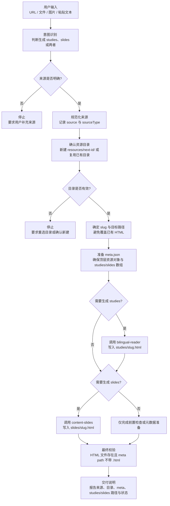

# AI Doc Creator

使用本技能把链接、文件、图片或文本编排为项目内的离线学习资源。它是 `resources/` 创建流程的统一入口，只负责理解用户意图、确定输出位置、维护 `meta.json` 映射，并串行调用下游生成技能完成实际 HTML 产物。

本技能只能按需调用以下两个技能：

- `bilingual-reader`：生成中英双语精读页，写入 `resources/<resource-folder>/studies/<slug>.html`。
- `content-slides`：生成 16:9 HTML 幻灯片，写入 `resources/<resource-folder>/slides/<slug>.html`。

## 触发时机

当用户要求从一个来源生成 AI 文档、学习资料、双语精读页、slides、PPT、presentation、HTML deck、文章学习包，或只要求执行资源前置检查时，调用本技能。默认语言为中文，除非用户明确要求其他语言。

标准命令写法：

```text
ai-doc-creator <url / img / document content / file>
```

## 总体流程

本技能的核心路径是：先获取用户意图，再准备资源结构；需要同时生成时，必须先执行 `bilingual-reader` 生成 `studies`，再执行 `content-slides` 生成 `slides`，最后统一校验文件和 `meta.json` 的关联关系。



## 职责边界

### 本技能负责

1. 识别用户想要的交付物：`studies`、`slides` 或 `studies + slides`。
2. 规范化来源并记录 `source`、`sourceType`。
3. 让用户确认新建或复用 `resources/<resource-folder>/`。
4. 创建或修正资源目录结构：`meta.json`、`studies/`、`slides/`。
5. 生成安全稳定的 slug，并确定最终 HTML 路径。
6. 写入或更新 `meta.json` 中的 `studies[].path` 与 `slides[].path`。
7. 按固定顺序调用 `bilingual-reader` 与 `content-slides`。
8. 完成后校验元数据、目标文件和路径约定。

### 本技能不负责

1. 不自行生成 studies 页面内容。
2. 不自行生成 slides 页面内容。
3. 不读取或指定 `bilingual-reader` 的模板。
4. 不读取或指定 `content-slides` 的主题、动画或版式。
5. 不调用除 `bilingual-reader` 与 `content-slides` 之外的其他 skill。
6. 不在 `meta.json` 或完成说明中暴露模板名、主题名、视觉系统名或内部选择依据。

## 意图识别

首先解析用户的真实意图，并把请求归类为以下四种之一：

| 用户意图 | 触发信号 | 本技能动作 |
| --- | --- | --- |
| 只生成 `studies` | “精读页”、“双语阅读”、“中英对照”、“study page”、“学习页” | 只准备并生成 `studies/<slug>.html`，`slides` 保留为空数组或保持已有内容 |
| 只生成 `slides` | “slides”、“PPT”、“presentation”、“deck”、“演示文稿” | 只准备并生成 `slides/<slug>.html`，`studies` 保留为空数组或保持已有内容 |
| 同时生成 `studies + slides` | “学习资料”、“AI 文档”、“文章学习包”、“resource”、“资料库条目”，或用户未明确限制类型 | 同一资源目录、同一 slug，先生成 studies，再生成 slides |
| 仅做前置检查 | “检查资源目录”、“准备 meta”、“只规划路径” | 只规范化来源、确认目录、准备或检查 `meta.json`，不调用生成技能 |

如果用户没有明确要求只生成其中一种，默认按 **同时生成 `studies + slides`** 处理。

## 串行编排规则

当本次需要同时生成 `studies` 与 `slides` 时，必须严格串行执行：

1. 先完成来源规范化、资源目录确认、slug 选择和 `meta.json` 准备。
2. 调用 `bilingual-reader`，要求它把精读页写入已确定的 `resources/<resource-folder>/studies/<slug>.html`。
3. 确认 `bilingual-reader` 完成后，再调用 `content-slides`。
4. 调用 `content-slides`，要求它把幻灯片写入已确定的 `resources/<resource-folder>/slides/<slug>.html`。
5. 两个技能都完成后，统一检查：
   - `studies/<slug>.html` 存在且 `meta.json` 中有对应 `studies[].path: "<slug>"`。
   - `slides/<slug>.html` 存在且 `meta.json` 中有对应 `slides[].path: "<slug>"`。
   - `path` 字段不包含 `.html`。
   - `source` 与 `sourceType` 可追溯。

不得并行调用 `bilingual-reader` 和 `content-slides`。`slides` 生成必须等待 `studies` 流程结束，以保证同一来源、同一资源目录和同一 slug 的资源关系稳定。

## Markdown 资源生成与人工确认门控

在调用下游技能生成 HTML 之前，`ai-doc-creator` 必须先为当前技能生成一份可人工审阅的 Markdown 资源交接文件。该文件用于承载来源正文、来源元数据、目标技能和链接清单，并作为后续 `bilingual-reader` 或 `content-slides` 的来源依据。

Markdown 文件名必须使用文章标题生成的 slug，例如 `resources/07/what-is-loop-engineering-ai-coding-agents.md`。不得创建、复制或要求下游依赖 `source.md`；新资源和更新资源都不能新增 `source.md`。下游生成或审阅产生的中间数据统一归档到 `resources/<resource-folder>/artifacts/`，不得散落在资源根目录。

### 脚本入口

本技能提供确定性脚本：

```bash
python3 .skills/ai-doc-creator/scripts/resource_markdown.py generate \
  --skill bilingual-reader \
  --source "https://example.com/article" \
  --source-type url \
  --title "Article title" \
  --body-file /path/to/source-body.txt \
  --output-dir resources/05 \
  --slug article-title
```

支持命令：

| 命令 | 作用 |
| --- | --- |
| `generate` | 为单个技能生成 `<slug>.md`，写入 `.ai-doc-creator-state.json`，状态为 `generated`。 |
| `confirm` | 在人工确认 Markdown 的正文、格式、图片、表格、代码块、链接和阅读顺序全部正常后，将该技能状态标记为 `confirmed`。 |
| `start-parallel` | 只有在指定 `gate-skill` 已人工确认后，才允许把其他技能标记为可启动的并行生成任务。 |

### Markdown 文件契约

生成的 Markdown 必须满足：

1. 包含 `Source`、`Source type`、`Skill`、`Generated` 元数据行。
2. 正文非空，且只基于可追溯来源写入。
3. 自动汇总正文中的 Markdown 链接和裸 URL 到 `## Links`，便于人工核对链接有效性。
4. 不写入模板名、主题名或下游技能内部实现细节。
5. 文件名必须是 `<slug>.md`，其中 `<slug>` 与 `studies[].path` / `slides[].path` 一致；禁止生成 `source.md`。

### Artifacts 归档契约

中间产物必须统一放入 `resources/<resource-folder>/artifacts/`：

1. `data.json`、`<slug>.data.json`、review 报告、状态文件和事件日志都写入 `artifacts/`。
2. 资源根目录只保留最终映射文件和可追溯正文：`meta.json`、`<slug>.md`、`studies/`、`slides/`。
3. `.ai-doc-creator-state.json` 与 `.ai-doc-creator-events.jsonl` 固定写入 `artifacts/`，用于后续定位问题。
4. `artifacts/` 不参与前端资源扫描；不得在 `meta.json` 中引用 `artifacts/` 下的文件。

### 多 studies 资源规则

如果同一个 `resources/<resource-folder>/` 中需要放置多个 `studies`，Markdown 交接文件也必须按每个 study 分别生成多份，而不是把多个 study 合并到同一个 Markdown 中：

- 每个 `studies/<slug>.html` 必须对应一份独立的 `<slug>.md`。
- 每份 Markdown 只承载该 study 自己的来源正文、元数据、链接清单和人工确认状态。
- `meta.json` 中追加多个 `studies[]` 条目时，必须逐条确认其 `path` 与对应 `<slug>.md`、`studies/<slug>.html` 一致。
- 多份 Markdown 可共享同一个 `source`，但不得共享同一个 `slug`；如果目标 `<slug>.md` 已存在，必须像 HTML 一样追加最小后缀，例如 `topic-2.md`、`topic-3.md`。
- 只有某个 study 的 Markdown 已人工确认后，才能调用 `bilingual-reader` 生成该 study 的 HTML；未确认的其他 study 不得提前生成。

示例：

```text
resources/05/
├── agent-runtime.md
├── agent-evaluation.md
├── studies/
│   ├── agent-runtime.html
│   └── agent-evaluation.html
└── meta.json
```

### 人工确认机制

Markdown 生成后必须停止，并使用 `AskUserQuestion` 要求人工确认：

```text
已生成 Markdown：<absolute-path>。请确认该技能资源的正文、格式、图片、表格、代码块、链接和阅读顺序是否全部正常无误？
```

只有用户明确选择继续后，才能执行：

```bash
python3 .skills/ai-doc-creator/scripts/resource_markdown.py confirm \
  --skill bilingual-reader \
  --slug article-title \
  --reviewer "<human-name-or-agent-session>" \
  --notes "正文、格式、链接已确认" \
  --output-dir resources/05
```

当同一资源目录内存在多个同 skill 的 Markdown 时，`confirm` 必须传入 `--slug`，确保只确认当前 study 对应的 Markdown。

未确认前不得调用下游 HTML 生成流程，也不得启动其他技能资源的并行生成任务。

### 并行控制规则

`start-parallel` 只控制“其他技能资源是否可以开始生成”的门禁，不改变同一资源中 `studies + slides` 的串行 HTML 生成规则。也就是说：

- 单个资源同时生成 `studies + slides` 时，仍然先 `bilingual-reader` 后 `content-slides`。
- 如果有多个技能资源需要并行准备，必须先确认当前 `gate-skill` 的 Markdown 正常。
- 未确认时，脚本会返回错误并保持 `.ai-doc-creator-state.json` 中 `parallel.allowed: false`。
- 确认后，脚本会写入 `parallel.allowed: true` 和待启动任务列表。

示例：

```bash
python3 .skills/ai-doc-creator/scripts/resource_markdown.py start-parallel \
  --gate-skill bilingual-reader \
  --next-skill content-slides \
  --output-dir resources/05
```

### 日志与状态管理

每次生成、确认和并行放行都会写入：

| 文件 | 内容 |
| --- | --- |
| `artifacts/.ai-doc-creator-state.json` | 当前每个技能资源的状态、Markdown 路径、来源、生成时间、确认人、确认备注和并行门控状态。 |
| `artifacts/.ai-doc-creator-events.jsonl` | 追加式事件日志，记录 `markdown_generated`、`markdown_confirmed`、`parallel_generation_ready` 等事件。 |

这些状态文件是流程审计记录，不属于最终前端资源展示内容。默认保留在 `artifacts/` 中，便于后续定位问题。

## 核心原则

- 资源根目录固定为项目根目录下的 `resources/`，不得写到外部目录。
- 创建任何 HTML 前必须先让用户确认：新建资源目录，或使用哪个已有 `resources/<resource-folder>/`。
- 如果用户已给出合法资源目录，仍需确认本次使用该目录还是新建目录。
- 更新某一个资源时，只允许修改该资源目录下的 `meta.json` 和对应产物；不得重写或刷新其他 `resources/<id>/meta.json` 的 `updatedAt`、数组顺序或任何字段。
- 不按 `source` 自动复用目录，也不校验 `meta.json` 中是否已有相同 `source` URL。
- 只做位置和元数据准备；页面内容、视觉、动画和完整 HTML 只能由 `bilingual-reader` 或 `content-slides` 生成。
- 本技能只允许调用 `bilingual-reader` 与 `content-slides`；跨技能约束只能写在本技能中，并通过调用参数传递。
- 禁止把来源处理、内容生成、视觉设计或前端实现委托给除上述两个技能之外的任何 skill。
- 本技能不得自行选择、创建、命名、描述或改写任何 studies 模板、slides 主题、视觉系统、版式结构或尺寸规则。
- studies 的模板选择只能在 `bilingual-reader` 内部完成，并且只能从 `bilingual-reader` 已预设的模板中随机选择或按其自身规则选择；`ai-doc-creator` 不读取模板清单、不指定模板名称、不要求下游使用某个模板。
- slides 的设计只能在 `content-slides` 内部完成，并且只能基于 `content-slides` 已预设的主题、结构和尺寸规则；`ai-doc-creator` 不读取主题清单、不指定主题名称、不发明主题或模板。
- 最终产物、`meta.json` 和完成说明中不得出现模板名称、模板描述、主题名称、主题描述或“使用了某某模板”的表述；这些只属于下游技能内部实现细节。

## 详细工作流

### 1. 获取并确认用户意图

输入可以是 URL、本地文件、图片、附件说明或粘贴文本。先判断用户希望生成哪类资源：

- `studies`
- `slides`
- `studies + slides`
- 仅资源前置检查

如果来源缺失，停止并要求用户补充来源。除非用户明确要求只生成其中一种，否则默认生成 `studies + slides`。

### 2. 规范化来源

- URL：仅去除首尾空白和末尾单个 `/`，不改写协议、域名、路径、query、hash 或大小写。
- 文件、图片、粘贴文本：记录可读来源；能确定原始路径或 URL 时写入 `source`。
- `sourceType` 只能使用：`url`、`file`、`image`、`text`。

### 3. 确认资源目录

- 新建：扫描 `resources/` 下顺序编号目录，使用最大编号加一；无编号目录时从 `01` 开始。
- 复用：将输入规范化为 `resources/<resource-folder>/`，目录不存在则停止并要求重选或确认新建。
- 确保 `meta.json` 存在且顶层为资源对象；按生成类型确保 `studies/`、`slides/` 存在。

创建任何 HTML 前必须先让用户确认：新建资源目录，或使用哪个已有 `resources/<resource-folder>/`。如果用户已给出合法资源目录，仍需确认本次使用该目录还是新建目录。

### 4. 确定 HTML 文件名

- 优先使用文章、文档或页面标题生成 `<title-slug>.html`。
- 英文转小写；空格和非法字符 `/ \ : * ? " < > |` 替换为 `-`；中文保留。
- 合并连续 `-`，去掉首尾标点，长度约 60 字符以内，扩展名固定 `.html`。
- 无标题时，URL 使用最后一个有意义路径片段，其他输入使用简短语义名称。
- 如目标文件已存在，追加最小后缀 `-2`、`-3`，不得覆盖。

同时生成时，默认 `studies` 与 `slides` 使用同一个 slug，分别写入不同子目录。

### 5. 更新 meta.json

- 顶层必须是资源对象，包含 `id`、`source`、`sourceType`、`studies` 和 `slides`。
- `studies` 每项默认字段：`title`、`name`、`description`、`tags`、`path`、`language: "zh-CN"`、`createdAt`、`updatedAt`。
- `sourceType`：URL 为 `url`，文件为 `file`，图片为 `image`，粘贴文本为 `text`。
- `id`：资源对象通常用资源文件夹编号。
- 精读页写入 `studies: [{ "path": "<slug>", ... }]`。
- 幻灯片写入 `slides: [{ "id": "1", "path": "<slug>", ... }]`。
- 每次生成更新 `updatedAt`；新建 meta item 同时写 `createdAt`。

如果只生成 `studies`，仍保留 `slides` 字段；如果只生成 `slides`，仍保留 `studies` 字段。未生成的数组可以为空，但不能省略字段。

### 6. 调用 bilingual-reader 生成 studies

当意图包含 `studies` 时，调用 `bilingual-reader`。调用参数必须包含：

- 默认语言。
- 规范化后的来源。
- 来源类型。
- 资源目录。
- `meta.json` 路径。
- 目标 HTML 路径：`resources/<resource-folder>/studies/<slug>.html`。
- 内容忠实度要求：必须忠于来源，不臆造事实、数据、作者或引用。
- 输出约束：写入指定文件，不另建 `index.html`，不改变路径和文件名，不在最终 HTML 或完成说明中暴露模板名称或模板描述。

`bilingual-reader` 的模板随机选择、模板合法性校验、页面结构和最终 HTML 都由 `bilingual-reader` 内部负责。`ai-doc-creator` 不读取模板清单、不指定模板名称、不要求下游使用某个模板。

### 7. 调用 content-slides 生成 slides

当意图包含 `slides` 时，调用 `content-slides`。如果本次也包含 `studies`，必须等待 `bilingual-reader` 完成后再调用。

调用参数必须包含：

- 默认语言。
- 规范化后的来源。
- 来源类型。
- 资源目录。
- `meta.json` 路径。
- 目标 HTML 路径：`resources/<resource-folder>/slides/<slug>.html`。
- 16:9 幻灯片要求：使用 `content-slides` 的标准固定舞台和自包含 HTML 约束。
- 内容忠实度要求：必须忠于来源，不臆造事实、数据、作者或引用。
- 输出约束：写入指定文件，不改变路径和文件名，不创建尺寸不符合预设的 slides，不在最终 HTML 或完成说明中暴露主题名称或主题描述。

`content-slides` 的主题预设选择、版式结构、视口尺寸和最终 HTML 都由 `content-slides` 内部负责。`ai-doc-creator` 不读取主题清单、不指定主题名称、不发明主题或模板。

### 8. 下游生成边界

- 如果用户向 `ai-doc-creator` 指定模板、主题、视觉风格或 slides 尺寸，本技能不得自行解释或落地；应把该意图原样作为用户偏好传给对应下游技能，由下游技能按自身预设决定是否接受。
- 若下游技能不能基于自身预设满足用户指定模板、主题或尺寸要求，必须停止并要求用户调整，不得由 `ai-doc-creator` 补造模板、主题或非标准尺寸。

### 9. 最终校验
完成生成后必须检查：

1. 目标 HTML 文件已写入预期位置。
2. `meta.json` 顶层是资源对象，不是数组或嵌套对象。
3. `id` 与资源目录编号一致。
4. `source` 和 `sourceType` 正确记录来源。
5. `studies[].path` 与 `resources/<resource-folder>/studies/<slug>.html` 文件名一致，且不含 `.html`。
6. `slides[].path` 与 `resources/<resource-folder>/slides/<slug>.html` 文件名一致，且不含 `.html`。
7. 未在 `meta.json`、HTML 可见内容或完成说明中暴露模板名、主题名或内部选择依据。

### 10. 产物信息边界

- `ai-doc-creator` 不在 `meta.json` 中记录模板名、模板描述、主题名、主题描述、尺寸实现细节或视觉系统名称。
- 完成说明只报告来源、资源目录、meta 路径、studies/slides 目标路径、执行状态和 `path` 关联结果。
- 完成说明不得报告实际使用的 studies 模板、slides 主题预设或选择依据；模板和主题属于下游技能内部实现细节。

## 技能边界

- `ai-doc-creator` 是资源创建编排层，只维护本目录下的技能说明，并且只编排 `bilingual-reader` 与 `content-slides`。
- `bilingual-reader` 与 `content-slides` 是被调用的生成能力，调用时传入来源、输出目录、目标 HTML 路径和元数据要求。
- `bilingual-reader` 与 `content-slides` 自行负责内部模板、主题、结构和尺寸选择；`ai-doc-creator` 不参与选择，也不要求下游技能创造新视觉方向。
- 任何其他 skill 都不属于本流程：不读取、不调用、不作为前置或兜底能力。
- 应在本技能的调用要求中显式声明目标路径，并在完成后核对 `meta.json` 与实际 HTML 文件是否一致。

## meta.json 示例

```json
{
  "id": "01",
  "source": "https://example.com/article",
  "sourceType": "url",
  "studies": [
    {
      "title": "中文标题",
      "name": "中文标题",
      "description": "中文简介",
      "tags": ["AI Agent", "工程实践"],
      "path": "topic-a",
      "language": "zh-CN",
      "createdAt": "2026-06-13T00:00:00Z",
      "updatedAt": "2026-06-13T00:00:00Z"
    }
  ],
  "slides": [
    {
      "id": "1",
      "path": "topic-a",
      "createdAt": "2026-06-13T00:00:00Z",
      "updatedAt": "2026-06-13T00:00:00Z"
    }
  ]
}
```

## 质量要求

- 生成内容必须忠于来源，不臆造事实、数据、作者或引用。
- 中文标题、简介、标签、说明文案和交付说明优先使用中文。
- 注释只用于解释非显而易见的步骤；保持输出路径和元数据清晰可追踪。

## 完成标准

完成后应明确输出：

- 来源和来源类型。
- 用户确认的新建或复用资源目录。
- 使用或创建的 `resources/<resource-folder>/meta.json`。
- `bilingual-reader` 目标 HTML 路径及执行状态（如适用）。
- `content-slides` 目标 HTML 路径及执行状态（如适用）。
- 最终 meta 对象中的 `studies[].path` 与 `slides[].path` 关联结果。
